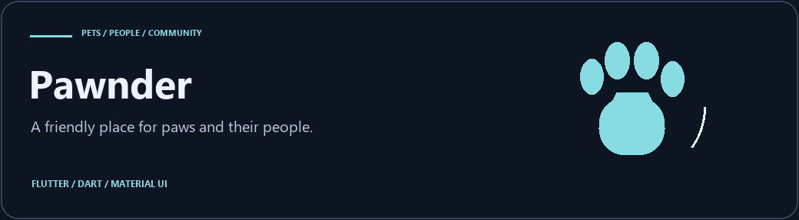

<div align="center">



# Pawnder

**A friendly place for paws and their people.**


[Overview](#overview) &nbsp; · &nbsp; [Run locally](#run-locally) &nbsp; · &nbsp; [Explore the repository](https://github.com/mcampo0215/Pawnder_Frontend)

</div>

---

## Overview

A Flutter frontend prototype for pet discovery and community interactions. The current screens include onboarding, pet browsing, pet details, missing-pet posts, listings, profile views, and sample message threads.

| Discover | Connect | Create |
| :--- | :--- | :--- |
| Browse sample pets and explore detail screens. | Navigate community posts, missing-pet listings, and message layouts. | Explore the listing form and photo-selection interface. |

## Run locally

Use Flutter with Dart compatible with `^3.10.4`, plus the native toolchain for your chosen target:

```sh
flutter pub get
flutter devices
flutter run
```

The app starts at onboarding and registers routes for registration, login, and home in `lib/main.dart`.

## Explore the interface

| Source | Responsibility |
| :--- | :--- |
| [lib/screens/auth/](lib/screens/auth/) | Onboarding, login, registration, and password-reset interfaces. |
| [lib/screens/home/home_screen.dart](lib/screens/home/home_screen.dart) | Sample pets and community content. |
| [lib/screens/home/pet_details_screen.dart](lib/screens/home/pet_details_screen.dart) | Pet information and contact navigation. |
| [lib/screens/home/listing_screen.dart](lib/screens/home/listing_screen.dart) | Listing form and photo-selection flow. |
| [lib/screens/home/chat_screen.dart](lib/screens/home/chat_screen.dart) | Sample conversation list. |
| [lib/widgets/](lib/widgets/) | Reusable cards, search, categories, navigation, and image fallbacks. |

## Current scope

This is a frontend prototype with hard-coded sample content and placeholder actions. Login navigation does not establish a real authenticated backend session. Networking, secure-storage, WebSocket, and environment packages are declared, but their presence does not mean a production service is integrated. No backend or required `.env` setup is present in the current app entry point.

The animated paw is README artwork, not a recording of the app.

## Development

```sh
flutter analyze
flutter test
```

---

<p align="center"><a href="#pawnder">Back to the top</a></p>
